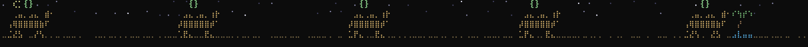
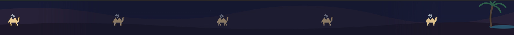

# rakuda-theme (camel caravan)

[日本語](README.md) | English






A Claude Code theme: a camel caravan walks slowly from left to right across a moonlit desert.
Each camel's load shows the tool Claude is running. When the answer is back, the camels carry their loads to the oasis and sit down to rest. The stars twinkle overhead.

("Rakuda" is Japanese for camel.)

## What it looks like

- **Terminal**: a four-row band above the prompt, with camels, a crescent moon, stars and an oasis drawn in braille dots.
- **Desktop app**: a scene behind the chat, with the night sky, dunes, the oasis and the caravan.

## What the camels carry

The load tells you what Claude is doing right now.

| What Claude is doing | Load | In the terminal |
| --- | --- | --- |
| Reading a file (Read and similar) | Slip of paper | A white square in dots |
| Searching (Grep, Glob, web search) | Magnifying glass | A blue ring and handle in dots |
| Writing or editing code (Edit, Write) | `{}` | A green `{}` |
| Running a command (Bash, PowerShell) | Gear | A grey `*` |
| Any other tool | Small chest | A red-brown box in dots |
| **A tool failed** | **Red `!`** | A red `!` |

- The red `!` shows for about six seconds after a tool returns an error, then the load goes back to what it was.
- A camel with no load means Claude has not used a tool yet, or the camel has already delivered its load to the oasis.
- When all the camels are sitting, Claude has finished answering and they are resting.

## Supported versions

- Claude Code in the terminal: **v2.1.287 or later**
- Desktop app: **v2.1.286 or later**

Check yours with `claude --version`.

## Install

This repository is also a marketplace, so one line installs the theme.
At the prompt of a Claude Code terminal session:

```
/plugin install rakuda-theme --marketplace TuesdayGhost/camel-caravan-theme
```

From a shell:

```
claude plugin install rakuda-theme --marketplace TuesdayGhost/camel-caravan-theme
```

Answer `y` when asked to add the marketplace, then pick a scope.
In the desktop app, click + next to the prompt box, open Plugins, enter `TuesdayGhost/camel-caravan-theme` under Add marketplace, then Add plugin.

## Usage

- `/rakuda-theme on` brings the caravan out and `/rakuda-theme off` puts it away. With no argument it toggles.
- Your choice carries over to later sessions.
- Nothing moves when your OS has animation effects turned off (reduced motion), or when Claude Code's `prefersReducedMotion` setting is on. Only the loads change with the tools.
- If you also have `ari-theme` (the ant trail theme) installed, bringing one out puts the other away.
- The command's replies are in Japanese: "キャラバンが出発したよ。" means the caravan has set off, and "キャラバンをしまったよ。" means it has been put away.

## What this mod does not do

- **No network access.** It sends and receives nothing.
- **No file reads or writes.** It touches no file in your project or anywhere else.
- **No automatic permission approvals.** It takes no part in permission decisions, and passes every tool's input and result through unchanged.
- **No use of prompts or conversation content.** It neither stores nor sends them. It uses only the name of the tool that ran and whether it failed.
- **No model calls.** It uses no extra tokens.

## What this mod does do

- Watches tool names and outcomes, and redraws the loads.
- Keeps your on or off choice (a single value) in Claude Code's storage for plugins.
- Runs a fixed command to read your OS animation setting at startup, and after that at most once every ten minutes: PowerShell on Windows, `defaults read` on macOS, `gsettings get` on Linux. Each one only reads the setting.
- Runs `/ari-theme off` when you bring this theme out, if `ari-theme` is installed.
- `/rakuda-theme off` clears the current backdrop theme, including one set by another plugin.

## Check it yourself

Before installing, you can have Claude Code inspect the code against the lists above.

```
git clone https://github.com/TuesdayGhost/camel-caravan-theme
claude plugin validate camel-caravan-theme
```

Look at two lines of the report:

- The `hooks:` line lists the events this mod reacts to: only `session.start`, `command.run`, `turn.start`, `tool.call`, `turn.complete` and `ui.render`.
- The `calls:` line lists the features this mod uses. You can confirm that `$.http` (network), `$.fs` (files), `$.model` (model calls) and `$.mcp` are **absent**. `$.process.run` is the OS setting read described above.

Run the bundled tests with `claude plugin test camel-caravan-theme`.

## Good to know

- The plugin API is still in early access, and a Claude Code update may break the theme.
- `claude plugin validate` inspects the code as written; it is not a safety guarantee. If in doubt, read the two files in `hooks/`, about 700 lines in all.

## License

[MIT](LICENSE)
