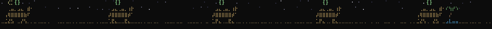
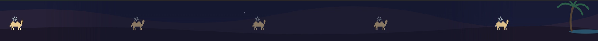

# rakuda-theme（ラクダのキャラバン）

日本語 | [English](README.en.md)






月の沙漠を、ラクダのキャラバンが左から右へゆっくり歩く Claude Code のテーマです。
Claude が動かしているツールに合わせてラクダの荷物が変わり、返答が終わるとオアシスまで運んで、座って休みます。夜空では星がまたたきます。

## 見え方

- **ターミナル**: プロンプトの上の4行の帯に、点字の点で描いたラクダ・三日月・星・オアシスが出ます。
- **デスクトップアプリ**: チャットの背景に、夜空・砂丘・オアシス・キャラバンのシーンを敷きます。

## ラクダが運ぶマーク

荷物を見ると、Claude がいま何をしているかが分かります。

| Claude がしていること | 荷物 | ターミナルでの見え方 |
| --- | --- | --- |
| ファイルを読む（Read など） | 紙切れ | 点で描いた白い四角 |
| 検索する（Grep・Glob・Web検索など） | 虫めがね | 点で描いた青い輪と柄 |
| コードを書く・編集する（Edit・Write） | `{}` | 緑の `{}` |
| コマンドを実行する（Bash・PowerShell） | 歯車 | 灰色の `*` |
| それ以外のツール | 小箱 | 点で描いた赤茶の箱 |
| **ツールが失敗した** | **赤い `!`** | 赤い `!` |

- 赤い `!` は、ツールがエラーを返したときに約6秒だけ出て、そのあと元の荷物に戻ります。
- 荷物がないラクダは、Claude がまだツールを使っていないか、もうオアシスに荷物を届けたあとです。
- 全員が座っているときは、Claude の返答が終わって休んでいるところです。

## 動く対応バージョン

- ターミナル版 Claude Code: **v2.1.287 以降**
- デスクトップアプリ: **v2.1.286 以降**

バージョンは `claude --version` で確かめられます。

## インストール

このリポジトリはマーケットプレイスも兼ねているので、1行で入ります。
Claude Code のターミナルセッションのプロンプトで:

```
/plugin install rakuda-theme --marketplace TuesdayGhost/camel-caravan-theme
```

シェルから:

```
claude plugin install rakuda-theme --marketplace TuesdayGhost/camel-caravan-theme
```

マーケットプレイスの追加を聞かれたら `y`、続いてスコープを選びます。
デスクトップアプリでは、プロンプト欄の横の + から Plugins を開き、Add marketplace に `TuesdayGhost/camel-caravan-theme` を入れて Add plugin します。

## 使い方

- `/rakuda-theme on` でキャラバンを出し、`/rakuda-theme off` でしまいます。引数なしなら切り替えです。
- 選んだ状態は次のセッションにも引き継がれます。
- OS の「アニメーション効果」（視差効果を減らす）設定がオフのとき、または Claude Code の `prefersReducedMotion` 設定がオンのときは、ラクダも星も動きません。荷物だけがツールに合わせて変わります。
- `ari-theme`（アリの行列のテーマ）も入れている場合、片方を出すともう片方は自動でしまわれます。

## この mod がしないこと

- **ネット通信をしません。** 外部への送信も受信もありません。
- **ファイルを読み書きしません。** プロジェクトのファイルにも、ほかの場所のファイルにも触りません。
- **許可を自動で承認しません。** 許可の判断には関わらず、ツールの入力も結果も書き換えずにそのまま通します。
- **プロンプトや会話の中身を使いません。** 保存も送信もしません。使うのは、動いたツールの名前と、それが失敗したかどうかだけです。
- **モデルを呼び出しません。** 追加のトークンは使いません。

## この mod がすること

- ツールの名前と成否を見て、荷物を描き変えます。
- 出す・しまうの選択（オンかオフかの1つの値）を、Claude Code のプラグイン用の保存領域に残します。
- OS のアニメーション設定を読むために、決まったコマンドを起動時と、そのあとは長くても10分おきに実行します。Windows では PowerShell、macOS では `defaults read`、Linux では `gsettings get` で、どれも設定を読むだけです。
- `ari-theme` が入っているときは、こちらを出すときに `/ari-theme off` を実行します。
- `/rakuda-theme off` は、ほかのプラグインが設定したテーマも含めて、そのときの背景テーマを消します。

## 自分で確かめる

入れる前に、コードが上のとおりかを Claude Code 自身に調べさせることができます。

```
git clone https://github.com/TuesdayGhost/camel-caravan-theme
claude plugin validate camel-caravan-theme
```

結果のうち、次の2行を見てください。

- `hooks:` の行: この mod が反応する出来事の一覧です。`session.start`、`command.run`、`turn.start`、`tool.call`、`turn.complete`、`ui.render` だけが並びます。
- `calls:` の行: この mod が使う機能の一覧です。`$.http`（ネット通信）、`$.fs`（ファイル）、`$.model`（モデル呼び出し）、`$.mcp` が**ない**ことを確かめられます。`$.process.run` は上に書いた OS の設定の読み取りです。

付属のテストは `claude plugin test camel-caravan-theme` で走ります。

## 知っておくこと

- プラグイン API はまだ早期アクセスで、Claude Code の更新で動かなくなることがあります。
- `claude plugin validate` は書かれたコードの点検で、安全の保証ではありません。気になるときは `hooks/` の2つのファイルを読んでください。全部で700行ほどです。

## ライセンス

[MIT](LICENSE)
